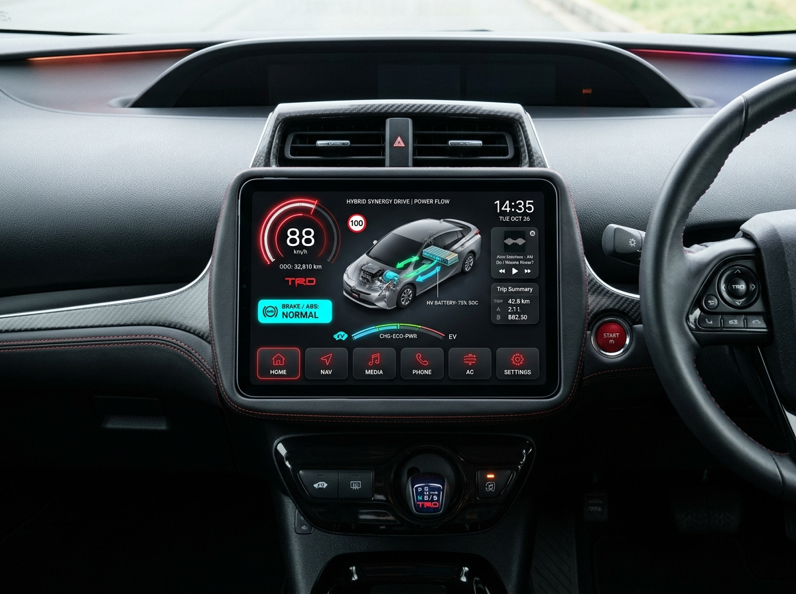
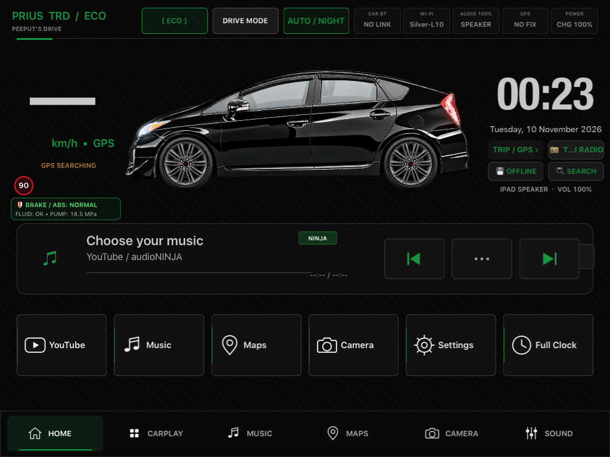
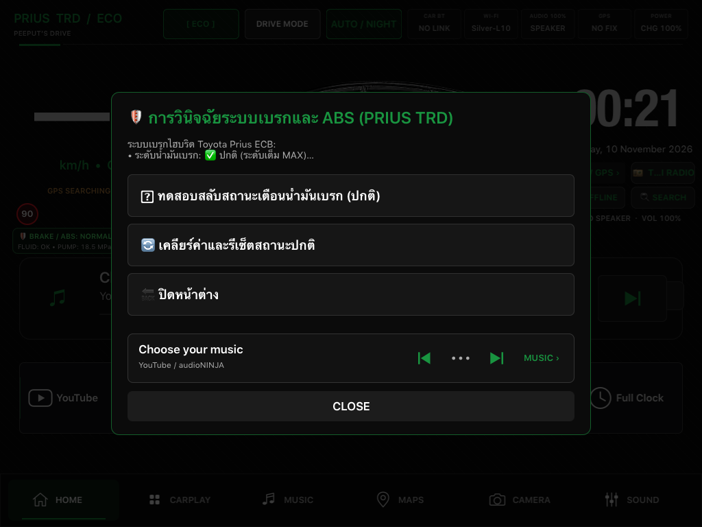
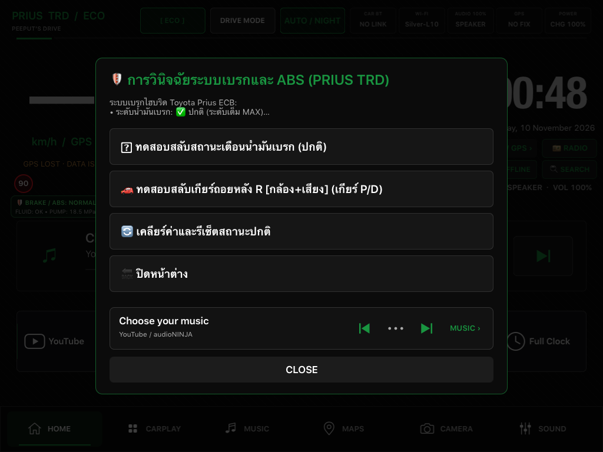
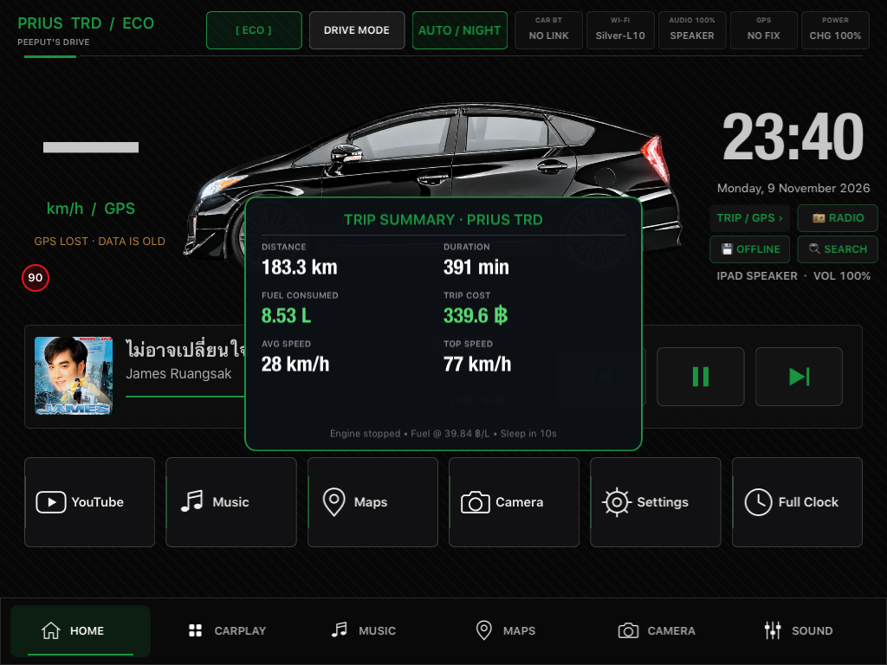
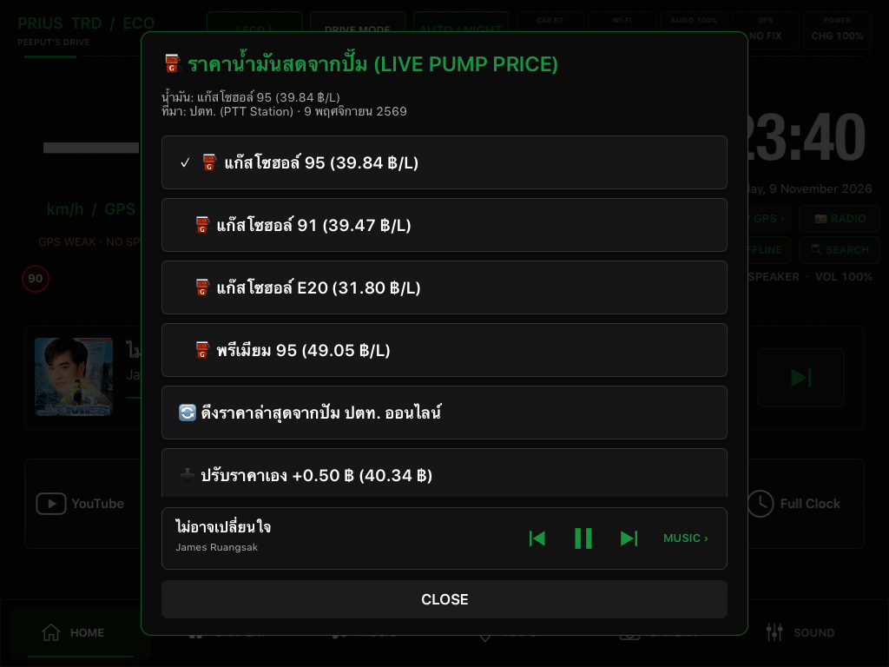
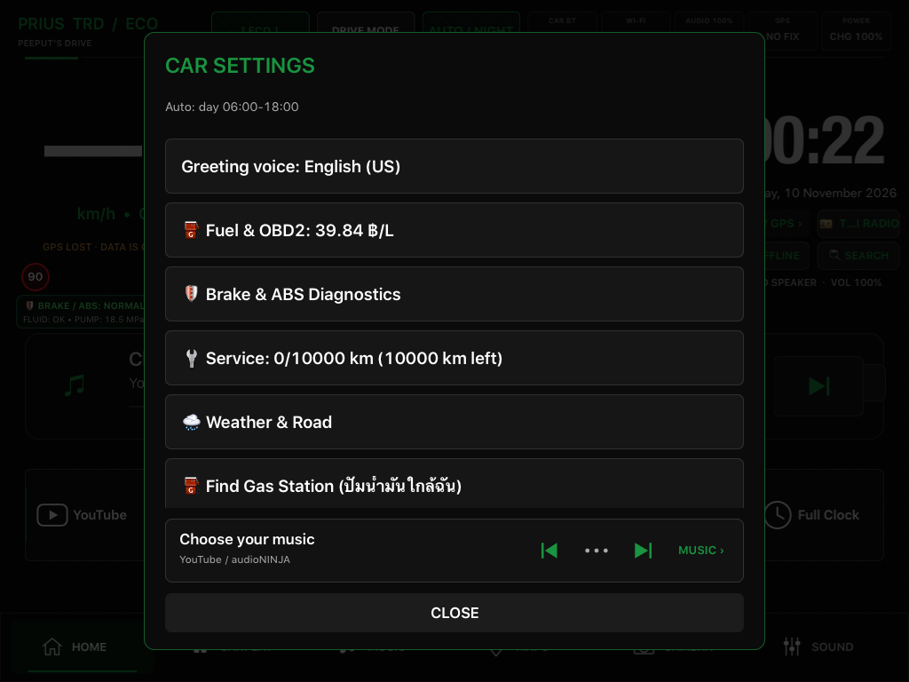
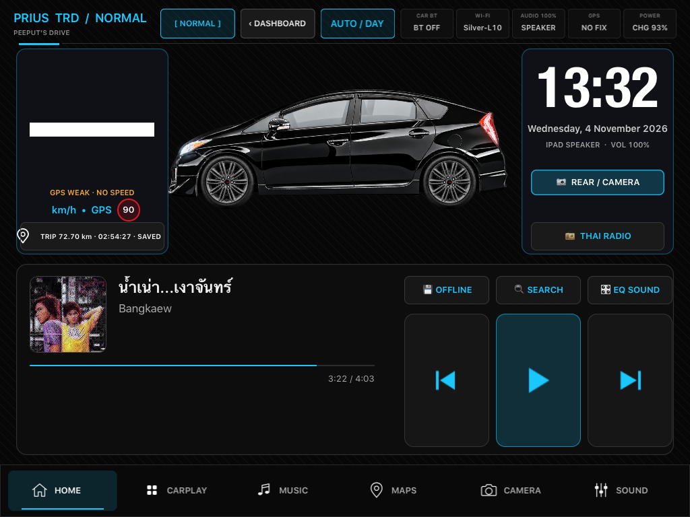
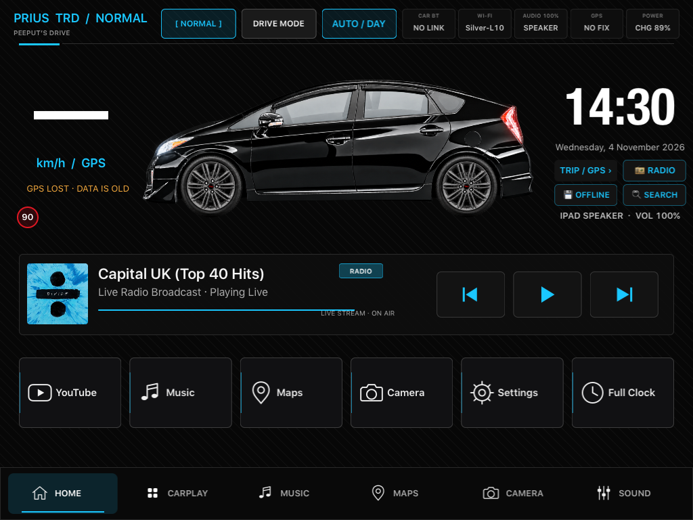

# Prius TRD CarDash - Screen Gallery 📸

> 📅 **วันที่บันทึกภาพล่าสุด:** 10 พฤศจิกายน 2026 (10 November 2026)  
> 🚘 **คลังรวมภาพหน้าจอจริงจากการรันบน iPad Mini 1 (iOS 9.3.6 Jailbreak) ในรถยนต์ Toyota Prius Gen 3 TRD:**

| ภาพตัวอย่าง | ชื่อฟังก์ชัน | คำอธิบาย |
| :--- | :--- | :--- |
|  | **หน้าจอหลักสัดส่วนพรีเมียม (Luxury Dashboard)** | จัดวางสัดส่วน 3 โซนลงตัว ไม่ทับซ้อน เกจ์ซ้าย รถตรงกลาง คอนโซลเพลงลอย นาฬิกาขวา |
|  | **ภาพคอนเซ็ปต์การออกแบบใหม่ (Design Concept)** | แบบจำลองห้องโดยสาร Prius Gen 3 TRD สไตล์สปอร์ตค็อกพิทล้ำสมัย |
|  | **หน้าจอหลัก + การ์ดแบตไฮบริด (Hybrid SOC)** | แสดงระดับแบตเตอรี่ไฮบริด 74% (EV Ready), อุณหภูมิอินเวอร์เตอร์ และ ECT บนจอจริง |
|  | **เมนูวินิจฉัยระบบไฮบริด (Hybrid Diagnostics)** | ตรวจสอบแบตเตอรี่ HV, อุณหภูมิอินเวอร์เตอร์/ECT, สัดส่วน EV % และปุ่มจำลองสถานะ |
|  | **ไดรฟ์โหมด + แถบวัดพลังงาน CHG-ECO-PWR** | แถบ LED วัดพลังงานไฮบริด CHG-ECO-PWR สไตล์ Prius TRD สปอร์ตลื่นไหลบนจอจริง |
|  | **หน้าจอหลัก (Home Dashboard)** | หน้าปัดความเร็ว, นาฬิกา, รถ Prius TRD สีดำ, การ์ดสถานะเบรก & ABS, และแผงคุมเพลง |
|  | **เมนูวินิจฉัยระบบเบรก & ABS** | ตรวจสอบระดับน้ำมันเบรก, กล่อง ABS/VSC, แรงดันปั๊มไฮดรอลิก (MPa) และปุ่มสลับทดสอบเตือน |
|  | **ระบบเกียร์ถอยหลัง R อัตโนมัติ** | สลับ Wi-Fi เข้ากล้องถอย, เปิดแอพ H109Viewer, หรี่เพลง 50% และส่งเสียงโซนาร์ถอยหลัง |
|  | **สรุปทริปจอดรถ (Trip Summary)** | ระยะทาง, เวลา, ลิตรน้ำมันที่ใช้ และคำนวณค่าน้ำมัน (฿) จากราคาปั๊มสดอัตโนมัติ |
|  | **ราคาน้ำมันสดจากปั๊ม (Oil API)** | เชื่อมโยงราคาน้ำมันสดแบบเรียลไทม์จากปั๊ม ปตท. (แก๊สโซฮอล์ 95, 91, E20, พรีเมียม 95) |
|  | **เมนูตั้งค่ารถยนต์ (Car Settings)** | ตั้งค่าเสียงต้อนรับ, ราคาน้ำมัน, โหมดประหยัดแบตเตอรี่, ระยะเปลี่ยนถ่ายน้ำมันเครื่อง |
|  | **โหมดการขับขี่สปอร์ต (Drive Mode)** | หน้าจอดิจิทัลค็อกพิท แสดงกราฟิกรถพร้อมล้อหมุนตามความเร็วจริง |
|  | **วิทยุออนไลน์ (Thai Live Radio)** | สถานีวิทยุยอดนิยม คลื่น COOL Fahrenheit, Met 107, JS100 ข่าวจราจร |
